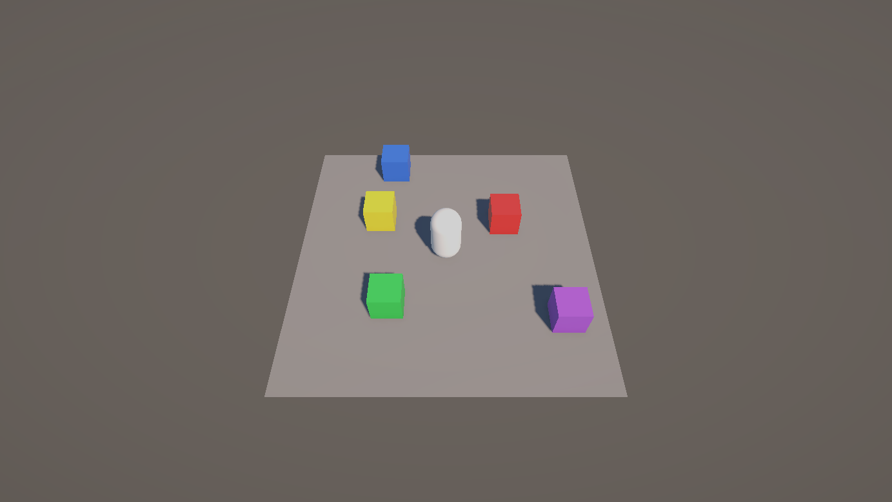
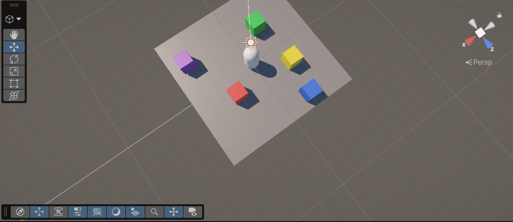
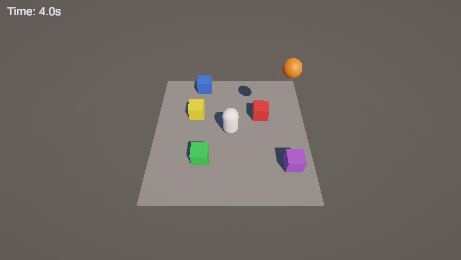
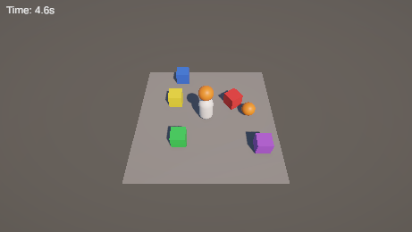
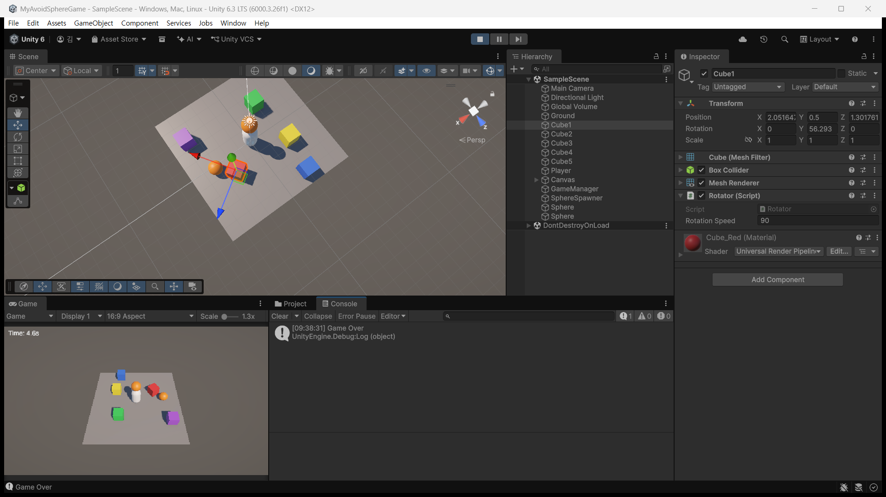

# 스크린샷

기본 미션(공 피하기) 실행 화면입니다. 게임 자체가 실패한 사례는 없어서 성공 화면만 넣었습니다. 작업 중에 막혔던 부분은 [로그](prompt-log.md) 마지막에 정리했습니다.

## 1. 씬 구성

회색 Ground 위에 색이 다른 Cube 5개를 놓고, 가운데에 Player(Capsule)를 뒀습니다.

## 2. Scene 뷰

위에서 내려다본 배치입니다. Ground 크기는 10×10입니다.

## 3. Sphere 낙하

시작하고 3초쯤 지나 첫 Sphere가 떨어지는 장면입니다. 좌상단에 생존시간이 보입니다.

## 4. 충돌과 Game Over

Player 머리 위로 Sphere를 떨어뜨려 일부러 맞췄습니다. 시간이 4.6초에서 멈췄습니다.

## 5. 에디터 전체

Console의 `Game Over` 한 줄, Hierarchy의 오브젝트들, Inspector의 Rotator(Rotation Speed 90)가 함께 보입니다. 창 제목에 `MyAvoidSphereGame`이 보여서 작업 중인 프로젝트가 맞다는 것도 확인할 수 있습니다.

[← 목록](DOCS.md)
