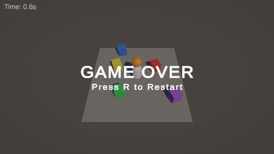

# 개선 1차: 재시작

## 뭘 바꿨나

- Game Over 되면 화면 가운데에 `GAME OVER / Press R to Restart`가 뜬다.
- R 누르면 씬을 다시 로드해서 처음부터 시작.

## 왜

전에는 Game Over 후 할 수 있는 게 없었다. 다시 하려면 Play를 껐다 켜야 했는데, 몇 판 해보면 이게 제일 귀찮았다.
게임오버도 Console에만 찍혀서 플레이 화면만 보면 죽었는지 바로 알기 어려웠다.

## 어떻게

- `GameManager`에 `gameOverPanel`을 연결. Game Over 때 켜고, 시작할 때 끈다.
- Game Over 상태에서만 R키를 받는다. 플레이 중에 실수로 눌러도 리셋 안 됨.
- 재시작은 `SceneManager.LoadScene`으로 현재 씬을 다시 로드. 상태를 하나하나 초기화하는 것보다 놓치는 게 없다.

## 확인

- [x] Sphere에 맞으면 패널이 뜸
- [x] 재시작하면 패널 꺼지고, 시간 0부터, 플레이어 원위치, Sphere 생성 다시 시작
- [ ] R키 직접 눌러보기 (에디터에서 가짜 키 입력이 막혀서 재시작 함수를 직접 호출해서 확인함)

[← 목록](DOCS.md)
