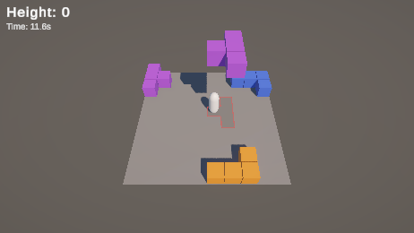
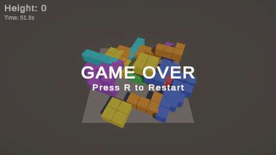
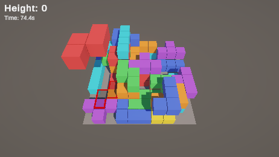
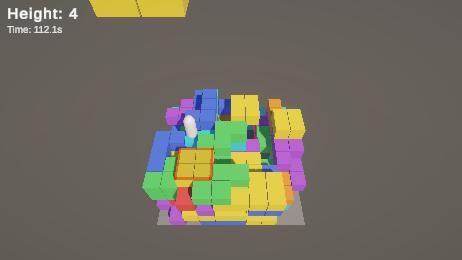

# 개선 2차: 블록 쌓고 올라가기

공 피하기에서 방향을 바꿨다. 떨어지는 블록을 피하면서, 쌓인 블록을 밟고 최대한 높이 올라가는 게임.

## 뭘 바꿨나

| 전 | 후 | 이유 |
|---|---|---|
| 공(Sphere)이 아무 데나 떨어짐 | 테트리미노 7종이 1×1 칸에 맞춰 떨어짐 | 쌓여야 발판이 되니까 칸에 딱 맞아야 함 |
| 떨어진 공은 8초 뒤 삭제 | 떨어진 블록은 그대로 남아 지형이 됨 | 밟고 올라가는 게 핵심 |
| 회전 Cube, 장식 Cube 5개 | 제거, 빈 필드에서 시작 | 칸에 안 맞는 오브젝트라 방해만 됨 |
| 생존시간만 표시 | `Height`(지금 서 있는 높이)를 크게, 시간은 작게 | 목표가 "높이"로 바뀜 |
| 이동만 가능 | Space 점프 | 블록 위로 올라가려면 필요 |
| 고정 카메라 | 플레이어 높이를 따라 올라감 | 높이 올라가면 화면 밖으로 나감 |
| 3초마다 고정 | 3초에서 90초에 걸쳐 1.5초까지 빨라짐 | 오래 버틸수록 긴장감 |

## 블록

- ProBuilder로 1칸짜리 큐브 4개를 합쳐서 7종 프리팹을 만들었다 (`Assets/Prefabs/Blocks`). 스포너가 `Instantiate`.
- 높이는 1칸. 눕혀서 떨어지고, 90도 단위로 랜덤 회전.
- 보이는 큐브는 0.96 크기라 칸 사이에 살짝 틈이 보인다. 충돌은 정확히 1×1.
- 낙하는 물리 중력이 아니라 직접 움직인다. 착지 높이를 미리 계산해두고 거기서 딱 멈춘다. 물리로 하면 튕기거나 미끄러져서 칸이 어긋난다.
- 떨어지는 중인 블록에 닿으면 Game Over. 착지한 블록은 그냥 발판.

## 낙하 알고리즘

목표는 두 가지였다. 불합리하게 죽지 않을 것, 그리고 쌓인 모양이 자연스러울 것.

### 불합리하지 않게

1. **착지 예고**: 블록이 생기는 순간 떨어질 칸에 반투명 그림자 + 빨간 외곽선이 뜬다. 땅에 가까워질수록 빨리 깜빡인다.
2. **공중에서 0.8초 대기**: 생기자마자 떨어지지 않는다. 예고를 보고 피할 시간을 준다.
3. **도망갈 칸 보장**: 플레이어를 노리는 블록이라도, 플레이어 칸 상하좌우 중 하나는 비워둔다. 그 칸이 1칸 이하 높이차라서 실제로 갈 수 있어야 한다.
4. **연속으로 안 노림**: 노리는 블록(35%) 다음엔 무조건 안 노리는 블록.
5. **떨어지는 블록끼리 안 겹침**: 떨어지는 중인 블록이 차지한 칸에는 새 블록을 안 놓는다.

### 자연스럽게

매번 후보 자리를 12개 뽑고 점수를 매겨 제일 좋은 데 떨어뜨린다. 점수는 낮을수록 좋다.

| 항목 | 점수 | 의미 |
|---|---|---|
| 블록 밑 빈 공간 | 칸당 +3 | 공중에 뜬 부자연스러운 모양을 피함 |
| 주변보다 2칸 이상 높아지는 변 | 변당 +1.5 | 점프로 못 오르는 벽을 덜 만듦 |
| 노릴 때: 플레이어와 거리 | 칸당 +4 | 가까울수록 좋음 |
| 안 노릴 때: 플레이어 바로 옆 | +8 | 괜히 옆에 떨어져서 놀라게 하지 않음 |
| 랜덤 | 0~2 | 매번 같은 패턴이 안 나오게 |

테트리스처럼 "가장 높은 칸에 걸려서 멈추는" 규칙이라 빈 공간이 생길 수 있는데, 점수로 그런 자리를 덜 고르게 했다.

## 조작감

- **가속/감속**: 최고 속도 6, 가속 60, 감속 80. 키를 떼면 거의 바로 서지만 뚝 끊기진 않음. 공중에선 60%만 적용.
- **점프**: 높이 1.3. 1칸은 오르고 2칸은 못 오른다 (한 번에 한 칸씩).
- **떨어질 때 중력 2배**: 붕 뜨는 느낌 줄이고 착지가 빠름.
- **코요테 타임 0.1초**: 블록 끝에서 살짝 떨어진 직후에도 점프 됨.
- **점프 버퍼 0.15초**: 착지 직전에 누른 점프도 착지하자마자 나감.
- **마찰 0**: 블록 옆면에 비비면서 점프할 때 벽에 붙는 문제 방지.
- **캡슐을 가늘게(반지름 0.35)**: 원래 0.5라 칸을 꽉 채워서 옆 칸에 떨어진 블록에 스치기만 해도 죽었다.
- **보이지 않는 벽**: 필드 밖으로 못 나감.

## Game Over 연출

Game Over 되면 필드의 모든 블록에 `Rotator`를 붙여서 제자리에서 빙글빙글 돌린다. 기본 미션 때 만든 `Rotator`를 다시 썼다. 그냥 재밌어서 넣음.

블록 Rigidbody에 보간(Interpolate)이 켜져 있으면 `Rotator`가 돌린 걸 Rigidbody가 덮어쓴다. 그래서 돌리기 시작할 때 보간을 끈다.

블록 21개 전부 `Rotator`가 붙고 각도가 계속 바뀌는 것까지 확인.

## 확인

MCP로는 키 입력을 못 넣어서, 오래 쌓이는 모습은 플레이어 충돌을 잠깐 끄고 봤다.

75초 동안 블록 30개 정도가 0~4층으로 쌓였다. 대부분 1칸 차이라 올라갈 만한 지형이 나왔다. 2칸 이상 벽도 가끔 생긴다.

플레이어를 4층 블록 위에 올려두니 `Height: 4`, 카메라도 4만큼 따라 올라감.

- [x] 블록이 칸에 맞게 떨어지고 착지 후 남음
- [x] 착지 지점에 그림자 + 빨간 외곽선, 착지하면 사라짐
- [x] 가만히 서 있으면 노리는 블록에 맞아 Game Over (11.7초)
- [x] 높이 점수, 카메라 따라가기
- [x] 점프 높이 약 1.3 (1칸 O, 2칸 X)
- [ ] WASD, Space로 직접 올라가 보기 (손으로 해봐야 함)

[← 목록](DOCS.md)
