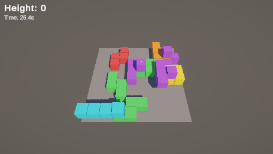
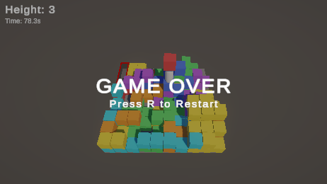

# 개선 3차: 빈칸 채우기

## 변경 내용

블록이 착지했을 때 밑이 비어 있는 칸이 있으면, 블록을 칸 단위로 쪼개서 빈칸 위에 있는 칸만 아래로 떨어뜨려 채우도록 했습니다.

```
옆에서 본 모습 (#은 블록, .은 빈칸)

전                      후
 ####   <- 위 블록       .###
 #...   <- 빈 공간       ##..   <- 빈칸 위의 칸이 떨어져서 채움
 ####                   ####
```

## 변경 이유

블록이 2개 겹쳤을 때, 위에 있는 블록의 한 칸 아래가 비어 있다면 아래로 떨어져서 채우는 게 좋지 않을까 하는 생각이 들었습니다.
2차에서는 블록이 가장 높은 칸에 걸려 멈추기 때문에 처마처럼 밑이 빈 모양이 생겼고, 이런 자리를 덜 고르도록 점수로 피하고만 있었습니다.

Claude와 이야기하면서 나온 걱정과, 거기에 대한 결정은 이렇습니다.

| 걱정 | 결정 |
|---|---|
| 착지한 줄 알았던 칸이 한 번 더 떨어지면 예고 없이 맞을 수 있다 | 일단 예고 없이 넣고, 불합리한지는 직접 플레이해서 판단하기로 했습니다 |
| 블록이 쪼개지면 테트리미노 모양이 깨진다 | 테트리미노는 예시라서 상관없다고 봤습니다. 모래 테트리스도 블록이 깨집니다 |
| 블록을 칸 단위로 다시 짜야 한다 | 하면 되는 일이라 진행했습니다 |

## 플레이에서 달라진 점

- 공중에 뜬 부분이 없어져서, 지형이 칸마다 높이 하나인 계단 모양이 됩니다. 어디를 밟을 수 있는지 보기 쉬워졌습니다.
- 블록이 착지한 뒤 일부가 툭 떨어지는 반응이 생겼습니다.
- 쪼개져서 떨어지는 칸에 맞아도 Game Over라서, 블록이 착지한 뒤에도 바로 밑에 붙어 있으면 위험합니다.

## 구현

- 착지할 때 칸마다 지금 높이를 확인합니다. 밑이 빈 칸이 하나라도 있으면 블록을 숨기고, 같은 색의 1칸 큐브(`BlockCell`) 4개로 바꿉니다.
- 빈칸 위에 있던 칸만 그 칸의 바닥까지 떨어집니다. 낙하 속도와 가속도는 원래 블록과 같습니다.
- 밑이 빈 칸이 없으면 쪼개지 않고 블록 모양 그대로 둡니다.
- 블록과 쪼개진 칸 모두 "떨어지는 중이면 위험"이라는 같은 규칙(`IFallingHazard`)을 따릅니다. 플레이어는 이걸로 Game Over를 판정합니다.
- 쪼개진 칸이 다 떨어질 때까지 그 칸들에는 새 블록을 떨어뜨리지 않습니다.
- 빈칸이 생기지 않으니 2차의 "블록 밑 빈 공간" 감점은 뺐습니다. 벽 판정도 칸이 떨어져 채운 뒤의 높이로 계산합니다.
- Game Over 회전 연출은 쪼개진 칸에도 똑같이 적용됩니다.

## 확인

칸이 떨어지는 시간이 0.3초도 안 돼서, 시간을 0.15배로 느리게 하고 잡았습니다.



앞줄 하늘색 I 블록은 오른쪽 한 칸만 초록 블록 위에 걸려 있고, 나머지 세 칸이 빈칸을 채우러 내려가는 중입니다.

53초 동안 쌓인 필드를 칸마다 검사했습니다. 블록 21개가 착지했고, 그중 10개가 쪼개져서 칸 40개가 됐습니다. 겹친 칸, 높이 밑에 남은 빈칸, 기록된 높이보다 위에 있는 칸은 모두 0개였습니다.



쪼개진 칸을 플레이어 머리 위에서 떨어뜨렸을 때 Game Over가 됐고, 쪼개진 칸에도 회전 연출이 붙었습니다.

- [x] 밑이 빈 칸만 떨어져서 채웁니다
- [x] 빈칸이 없으면 블록 모양 그대로 남습니다
- [x] 쌓인 뒤 겹침이나 빈칸이 없습니다
- [x] 떨어지는 칸에 맞으면 Game Over가 됩니다
- [ ] 예고 없이 떨어지는 칸이 불합리하게 느껴지는지 직접 플레이로 확인

[← 목록](DOCS.md)
