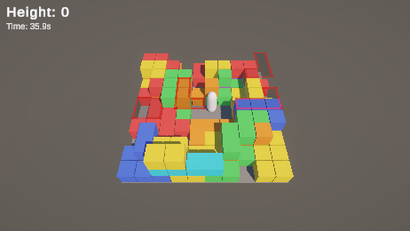

# 개선 4차: 웨이브

## 변경 내용

블록을 하나씩 떨어뜨리던 방식을, 여러 개를 한 번에 묶어(웨이브) 약간의 랜덤 간격을 두고 떨어뜨리는 방식으로 바꿨습니다. 시간이 지날수록 한 웨이브의 블록 수가 늘어납니다.

| 값 | 전 | 후 |
|---|---|---|
| 한 번에 떨어지는 블록 | 1개 | 3개에서 시작, 20초마다 +1, 최대 7개 |
| 간격 | 블록마다 3초 → 1.5초 | 웨이브마다 4초 → 2.5초 (90초에 걸쳐) |
| 웨이브 안 블록 사이 | 없음 | 0.1~0.4초 랜덤 |
| 플레이어를 노리는 블록 | 블록마다 35%, 연속 금지 | 웨이브당 최대 1개 (50% 확률로 섞임) |

## 변경 이유

아무것도 없는 처음 상태에서 블록이 1개씩만 떨어지니 너무 쉬웠습니다. 시작부터 일정 개수 이상 떨어져야 긴장감이 있고, 시간이 지나면서 한 번에 떨어지는 양이 늘어나는 쪽이 난이도가 자연스럽게 오른다고 봤습니다.

수치는 Claude가 추천한 값으로 먼저 넣고, 직접 플레이해 보면서 조정하기로 했습니다. 질문할 때 고려했던 다른 값은 아래와 같습니다.

- 2개에서 시작, 15초마다 +1, 최대 6개
- 웨이브 안 간격 0.3~0.8초

값은 전부 `BlockSpawner` Inspector에서 바꿀 수 있습니다.

## 플레이에서 달라진 점

(직접 플레이 후 작성)

## 구현

- `BlockSpawner`가 웨이브 간격마다 코루틴으로 웨이브를 시작합니다. 웨이브 안에서는 블록을 하나 만들 때마다 0.1~0.4초를 기다립니다.
- 웨이브 크기는 `3 + (경과 시간 / 20초)`이고, 7개를 넘지 않습니다.
- 노리는 블록은 웨이브마다 50% 확률로 1개만 섞고, 웨이브 안 순서는 랜덤입니다. 한 웨이브에 노리는 블록이 여러 개 오지 않게 했습니다.
- 도망갈 칸 보장(플레이어 상하좌우 중 한 칸은 비움)은 그대로입니다. 이미 떨어지고 있는 블록이 차지한 칸도 피하기 때문에, 같은 웨이브 블록끼리 겹치지 않습니다.
- Game Over가 되면 웨이브 중간이라도 남은 블록은 만들지 않습니다.

## 확인

플레이어 충돌을 끈 상태로 36초 동안 블록이 생기는 시각을 기록했습니다.

| 웨이브 | 시작 (초) | 블록 수 |
|---|---|---|
| 1 | 1.97 | 3 |
| 2 | 5.87 | 3 |
| 3 | 9.71 | 3 |
| 4 | 13.49 | 3 |
| 5 | 17.20 | 3 |
| 6 | 20.85 | 4 |
| 7 | 24.44 | 4 |
| 8 | 27.98 | 4 |
| 9 | 31.46 | 4 |
| 10 | 34.87 | 4 |

- 웨이브 간격은 3.9초에서 3.4초로 조금씩 줄고 있습니다 (90초에 2.5초).
- 20초가 지나면서 3개에서 4개로 늘었습니다.
- 웨이브 안 블록 사이 간격은 0.14~0.4초였습니다.
- 36초 동안 블록 35개가 떨어졌습니다. 2차 때는 같은 시간에 13개 정도였습니다.

착지 예고가 여러 개 동시에 보이는 모습입니다. 블록은 화면 위쪽 밖에서 생겨서, 플레이어는 주로 바닥의 빨간 외곽선을 보고 피하게 됩니다.

- [x] 시작부터 3개씩 떨어집니다
- [x] 시간이 지나면 웨이브 블록 수가 늘고, 간격이 줄어듭니다
- [x] 같은 웨이브 블록끼리 겹치지 않습니다
- [x] 직접 플레이하면서 수치 조정

[← 목록](DOCS.md)
