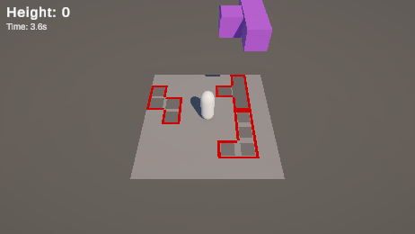
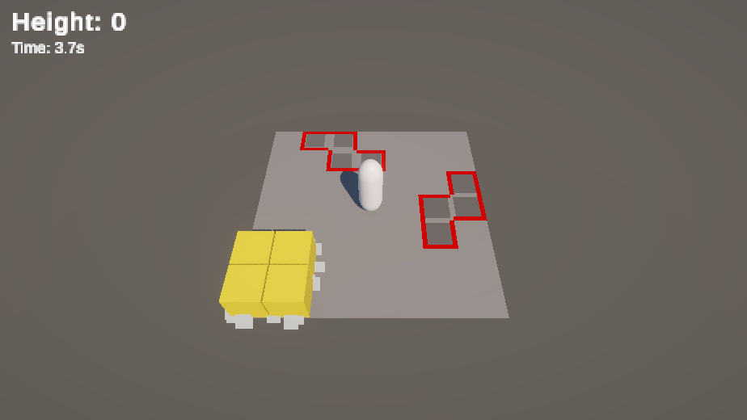

# 개선 5차: 낙하감과 착지 충격, 7×7 맵

## 변경 내용

- 블록이 일정한 가속으로 떨어지던 것을, 총 낙하 시간은 0.9초로 고정하고 처음엔 느리게, 끝에서 빠르게 떨어지도록 바꿨습니다.
- 블록이 착지하는 순간 카메라가 짧게 흔들리고, 착지한 칸 가장자리에서 먼지가 퍼집니다.
- 착지 예고 표시가 깜빡이던 것을, 남은 시간만큼 그림자가 차오르는 방식으로 바꿨습니다.
- 플레이어가 점프할 때 길쭉해지고, 착지할 때 납작하게 눌렸다가 돌아옵니다.
- 맵을 10×10에서 7×7로 줄였습니다.

## 변경 이유

블록이 떨어질 때 속도감이 없고, 착지해도 '쿵' 하는 느낌이 없어서 밋밋했습니다.

낙하는 "총 떨어지는 시간은 일정하지만 느리게 → 빠르게"가 좋겠다고 생각했습니다. 시간이 일정하면 예고가 뜬 뒤 언제 떨어질지 몸으로 익힐 수 있고, 끝에서 빨라지면 속도감이 생깁니다.

맵은 7×7로 줄였습니다. 웨이브 블록 수(3개 → 최대 7개)는 그대로 둬서, 같은 수의 블록이 더 좁은 곳에 떨어집니다.

## 결정한 것

| 질문 | 결정 |
|---|---|
| 낙하 곡선과 시간 | 0.9초, 3차 곡선 (공중 대기 0.8초는 그대로) |
| 착지 충격 | 카메라 흔들림, 먼지 파티클 |
| 추가 시각 피드백 | 예고 표시가 차오름, 플레이어 찌그러짐 |
| 7×7에서 웨이브 크기 | 그대로 (3 → 7) |

## 플레이에서 달라진 점

(직접 플레이 후 작성)

## 구현

- 낙하 위치는 `시작 높이 → 착지 높이`를 `t³`으로 보간합니다(`t`는 0~1의 경과 비율). 높이와 상관없이 항상 0.9초에 착지합니다. 곡선 지수와 시간은 블록 프리팹 Inspector에서 바꿀 수 있습니다.
- 쪼개진 칸이 빈칸을 채우러 떨어지는 건 거리가 짧아서 원래대로 중력 가속을 씁니다.
- 착지 연출은 `LandingEffects` 하나에 모았습니다. 블록 착지는 세기 1, 쪼개진 칸 착지는 0.5입니다.
- 카메라 흔들림은 착지 지점이 플레이어에 가까울수록 셉니다(0.25 → 0.05, 6칸 기준). 0.18초 동안 줄어들고, 따라가기 위치와는 따로 계산해서 흔들려도 카메라가 밀리지 않습니다.
- 먼지는 파티클 시스템 하나에서 칸마다 6개씩 가장자리로 뿌립니다. 웹 빌드에서도 확실히 그려지도록 착지 예고와 같은 셰이더(`Sprites/Default`)를 썼습니다.
- 예고 그림자는 블록이 생길 때 칸 크기의 15%에서 시작해, 착지 순간 칸을 꽉 채웁니다. 진해지는 정도도 같이 바뀝니다.
- 플레이어 찌그러짐은 보이는 캡슐만 자식 오브젝트로 떼어 늘이고 줄입니다. 콜라이더는 그대로라 판정에는 영향이 없고, 발바닥이 바닥에 붙어 있도록 위치도 같이 보정합니다.
- 7×7에 맞춰 바닥 크기, 보이지 않는 벽 위치, 카메라 거리를 줄였고, 플레이어는 가운데 칸에서 시작합니다.

## 확인

시간을 0.3배로 느리게 해서 첫 웨이브를 찍었습니다. 착지 예고마다 그림자가 다른 크기로 차오르고 있습니다. 먼저 생긴 블록일수록 그림자가 큽니다. 위쪽 보라색 블록은 낙하 중입니다.

노란 O 블록이 착지한 직후 둘레로 먼지가 퍼지는 모습입니다.

블록 12개의 생성부터 착지까지 시간을 재 보니 모두 1.73~1.74초였습니다(대기 0.8초 + 낙하 0.9초 + 프레임 오차). 생성 높이가 달라도 같습니다. 카메라는 흔들릴 때 최대 0.19 정도 움직였습니다.

처음에는 먼지가 칸 가장자리 바로 위에서 생겨 블록 옆면에 가려졌고, 바닥과 색도 비슷해서 거의 보이지 않았습니다. 생기는 위치를 칸 바깥쪽으로 옮기고, 크기를 키우고, 더 밝게 바꿨습니다.

7×7에서 웨이브를 그대로 두니 지형이 빨리 높아졌습니다. 플레이어 충돌을 끄고 돌렸을 때 46초 만에 평균 3.6층, 최고 7층이었습니다. 10×10에서는 36초에 평균 1.2층이었습니다.

- [x] 높이와 상관없이 낙하 시간이 일정합니다
- [x] 착지할 때 카메라가 흔들리고 먼지가 퍼집니다
- [x] 예고 그림자가 착지 시점에 맞춰 차오릅니다
- [x] 점프하면 늘어나고(세로 1.23배), 착지하면 눌렸다가(0.77배) 돌아옵니다
- [ ] 직접 플레이하면서 느낌과 수치 확인

[← 목록](DOCS.md)
