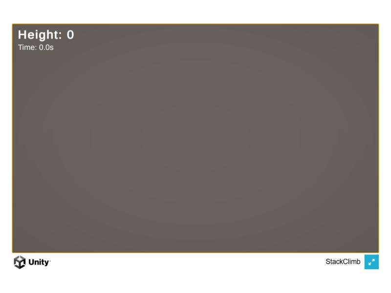
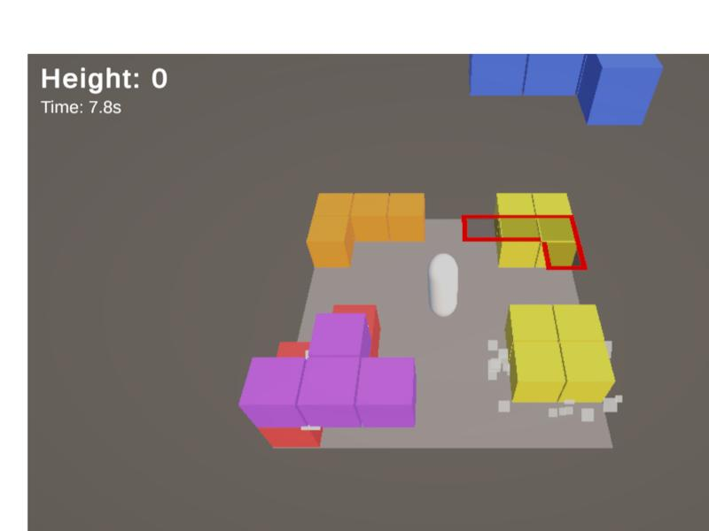

# 웹 빌드 오류: 3D 화면이 안 보임

웹 빌드를 로컬에서 실행해 보니 UI만 나오고 3D 화면이 비어 있었습니다. 원인을 찾아 고친 과정입니다.

## 증상

- 로딩은 끝나고 `Height`, `Time`, `GAME OVER` UI는 나오는데, 바닥·플레이어·블록이 없습니다.
- 게임 로직은 돌아가서 가만히 있어도 몇 초 뒤 Game Over가 됩니다.
- 콘솔에는 `Hidden/CoreSRP/CoreCopy`, `StencilDitherMaskSeed`, `HDRDebugView` 셰이더가 지원되지 않는다는 오류가 있었습니다.
- 파일을 `file://`로 직접 열면 WebGL은 아예 실행되지 않으므로, 로컬 서버(`python -m http.server`)로 열었습니다.

## 원인

WebGL 빌드의 퀄리티 레벨은 `Mobile`(0번)이라 `Mobile_RPAsset`이 적용됩니다. 여기에 **HDR이 켜져 있어서**(`Supports HDR`) 3D가 그려지지 않았습니다.

콘솔의 셰이더 오류는 원인이 아니었습니다. 그 셰이더들은 MSAA 해석과 디버그 화면용이라 웹에서 지원되지 않아도 렌더링에는 영향이 없습니다.

## 원인을 찾은 방법

콘솔 오류, 렌더 설정 파일 비교, 드로우콜 수 확인까지는 원인이 보이지 않아서, 설정을 바꿔 가며 다시 빌드했습니다.

| 빌드 | 바꾼 것 | 결과 |
|---|---|---|
| 1 | HDR 끔, Bloom 제거 | 3D가 나옴 |
| 2 | HDR만 끔 (Bloom 복구) | 3D가 나옴 |

Bloom을 되돌려도 정상이라, 원인은 HDR로 좁혀졌습니다.

## 고친 것

| 항목 | 이전 | 이후 |
|---|---|---|
| `Mobile_RPAsset`의 `Supports HDR` | 켬 | 끔 |
| WebGL 압축 | 없음 (wasm 약 55MB) | Gzip + Decompression Fallback (빌드 전체 약 20MB) |

압축은 GitHub Pages에 올릴 때를 대비해 같이 바꿨습니다. Pages는 Brotli용 응답 헤더를 붙여 주지 않아서 Gzip을 골랐고, 헤더가 없어도 로드되도록 Decompression Fallback을 켰습니다. 압축 설정이 `ProjectSettings`와 빌드 프로필(`Web - Desktop - Release`)에 따로 있어서 둘을 같게 맞췄습니다.

## 확인

압축한 최종 빌드를 로컬 서버로 열어 확인했습니다. 바닥, 플레이어, 블록, 착지 예고, 먼지가 모두 보입니다.

- [x] 3D 화면이 나옵니다
- [x] 압축 빌드가 헤더 없는 로컬 서버에서도 로드됩니다
- [x] 콘솔에 렌더링을 막는 오류가 없습니다 (위의 셰이더 메시지는 그대로 남지만 무해합니다)
- [ ] GitHub Pages에 올린 뒤 같은 화면이 나오는지 확인

[← 목록](DOCS.md)
